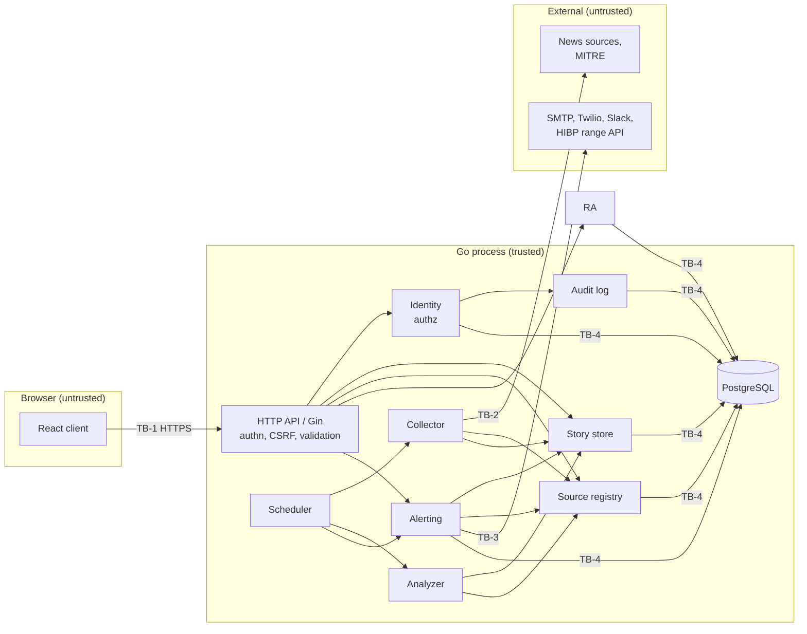

# Architecture: Good Morning Breach

This file owns HOW the system is built: its components, boundaries, technology, and data flow. `REQUIREMENTS.md` owns WHAT the system does. `DESIGN.md` owns how it looks. `SECURITY.md` owns the detailed controls. The application scaffold, one-source RSS ingestion, and the first authenticated dashboard slice are implemented; the remaining product workflows are still in progress.

Version pins were checked against official release and registry sources on 2026-11-16. The scaffold's Go and npm dependency trees were resolved, license-checked, and audited before being added. The npm production and full audits passed, and 44 installed packages had verified registry signatures. The original Go scaffold passed `go mod verify` and `govulncheck ./...`; all 55 modules had recognized permissive licenses. The 94-package npm tree includes 12 optional, platform-specific Lightning CSS packages under MPL-2.0; this is acceptable for this private, non-distributed service, but must be reconsidered before distribution. The Gin tree required patched `x/net`, `quic-go`, and `x/crypto` pins to pass the vulnerability gate. On 2026-11-16, the added pgx v5.13.0 and gofeed v1.5.0 tags were verified from upstream/Go module sources, their MIT licenses were checked, direct OSV queries returned no advisories, `govulncheck ./...` found no vulnerabilities, and `go-licenses check` passed for third-party dependencies. Continue these checks before adding other proposed packages.

## Required Architecture Inputs

- **Requirements and design sources:** `REQUIREMENTS.md` (FR-1 to FR-10, NFR-1 to NFR-4); `DESIGN.md`; `reports/Licensed cyber news sources.md`.
- **Target surfaces:** a web dashboard; background jobs for collection, analysis, the morning alert, and retention. Public APIs: none.
- **Runtime and deployment environment:** CONFIRMED (AQ-1): a single machine owned by the owner, for the owner only. The server listens on localhost only and uses a local TLS certificate (NFR-3.1). Alerts at 07:00 need that machine to be on and awake. Because availability is best effort (NFR-4.1), this is accepted. Dashboard links in text messages (FR-4.13) only open on this machine. Accounts beyond the owner's are supported (NFR-2.1) but can only be used on this machine.
- **Server framework:** Go with Gin (explicit choice).
- **Client frameworks:** ReactJS (explicit choice), built as a single-page app and served by the Go server.
- **API style:** a private JSON-over-HTTPS API used only by the bundled client. It is not a public API.
- **Authentication and session model:** email and password; TOTP is required by default per account and can be disabled for an individual account. A server-side session referenced by a cookie, with a 30-minute idle timeout and an 8-hour absolute timeout.
- **Outbound calls:** collection sources, MITRE, SMTP, Twilio, Slack webhooks, and the HIBP range API. There are no inbound connections from outside the machine.
- **Authorization model:** two roles, admin and user (FR-6.4), plus ownership checks on per-user settings (FR-6.12). Enforced in the server only.
- **Data store and expected scale:** PostgreSQL, one local instance on the same machine (CONFIRMED, AQ-2). Scale: at least 10 accounts (NFR-2.1) and 365 days of stories (FR-10.1). Story volume per day is UNKNOWN.
- **Logging library or platform logger:** Go standard library `log/slog`.
- **Security expectations:** owned by `SECURITY.md`. This file only names the enforcement points.

## Stack

| Technology | Pinned version / line | Justification | Status |
|---|---|---|---|
| Go | [1.27.4](https://go.dev/doc/devel/release) | Explicit choice: server. Includes `net/http`, `crypto`, `html/template`, `log/slog`, `net/smtp`, and `time`, which cover HTTP clients, email bodies (FR-4.12, NFR-3.4), logging, and scheduling without extra packages. Update to supported security patches deliberately. | CONFIRMED |
| Gin (`github.com/gin-gonic/gin`) | [v1.12.0](https://github.com/gin-gonic/gin/releases/tag/v1.12.0) (minimum Go 1.25) | Explicit choice: HTTP routing and middleware for the dashboard API. | CONFIRMED |
| React + React DOM | [19.3.1](https://github.com/react/react/releases/tag/v19.3.1) | Explicit choice: dashboard client (FR-5). Keep both packages on the same version. | CONFIRMED |
| React type declarations (`@types/react`, `@types/react-dom`) | [19.3.0](https://www.npmjs.com/package/@types/react/v/19.3.0) | Development-only TypeScript declarations needed to type-check React components. `@types/react-dom` requires the matching 19.3 type line. | CONFIRMED |
| Node.js | [26.13.1](https://nodejs.org/en/download/archive/v26.13.1) LTS (build machine only, not at runtime) | Needed to build the React client. It does not run in production. | CONFIRMED |
| Vite | [8.3.8](https://github.com/vitejs/vite/releases/tag/v8.3.8) | Builds and bundles the React client. React has no build tool of its own. | CONFIRMED |
| TypeScript | [7.0.2](https://github.com/microsoft/TypeScript/releases/tag/v7.0.2) | Type-checks the client and its API contracts, so mistakes in rendering untrusted data are caught at build time. | CONFIRMED (AQ-7, delegated decision) |
| PostgreSQL | 18.x (18.7 current; supported until 2030-11-14) | Stores stories, sources, accounts, settings, and records (FR-1 to FR-10). Its built-in full-text search covers keyword search (FR-5.5) without a separate search engine. | CONFIRMED (AQ-2) |
| `github.com/jackc/pgx/v5` | [v5.13.0](https://github.com/jackc/pgx/tree/v5.13.0) (minimum Go 1.25) | PostgreSQL driver and connection pool. The Go standard library has no PostgreSQL driver. The tagged release is MIT-licensed. | CONFIRMED |
| `golang.org/x/net` | [v0.62.0](https://pkg.go.dev/golang.org/x/net@v0.62.0) | Pins above Gin 1.12.0's vulnerable v0.51.0 and is used to parse untrusted HTML title markup safely. `govulncheck` found no reachable advisories at this pin. | CONFIRMED |
| `github.com/quic-go/quic-go` (Gin HTTP/3 dependency) | [v0.65.0](https://github.com/quic-go/quic-go/releases/tag/v0.65.0) | Explicitly pins above Gin 1.12.0's vulnerable v0.59.0; `govulncheck` found a reachable HTTP/3 advisory. Gin builds with this release. | CONFIRMED |
| `golang.org/x/crypto` (argon2id) | [v0.59.0](https://github.com/golang/crypto/tree/v0.59.0) | Password hashing (FR-6.5). The Go standard library has no memory-hard password hash. Also removes an unreachable OpenPGP advisory in Gin's dependency tree. | CONFIRMED |
| `github.com/pquerna/otp` | [v1.5.0](https://github.com/pquerna/otp/releases/tag/v1.5.0) | TOTP enrolment and checks (FR-6.5, FR-6.15). Not in the Go standard library. The tagged release is Apache-2.0 licensed (corrected after checking the upstream tag on 2026-11-17). | CONFIRMED |
| `golang.org/x/term` | [v0.48.0](https://pkg.go.dev/golang.org/x/term@v0.48.0) | Reads the bootstrap administrator password without echoing it to the terminal. The official Go sub-repository is BSD-3-Clause licensed and depends on the already-pinned `golang.org/x/sys` v0.50.0. Checked against the upstream tag and OSV on 2026-11-17. | CONFIRMED |
| `github.com/boombuler/barcode` (indirect) | [v1.1.0](https://github.com/boombuler/barcode/releases/tag/v1.1.0) | Required by `pquerna/otp`'s provisioning-key package even though this client displays the TOTP key for manual entry rather than generating a QR image. The upstream release is MIT-licensed, has no additional module requirements, and was checked against OSV on 2026-11-17. | CONFIRMED |
| `github.com/mmcdole/gofeed` | [v1.5.0](https://github.com/mmcdole/gofeed/releases/tag/v1.5.0) | Parses RSS, Atom, and JSON feeds from the FR-1.14 sources. Writing three feed parsers by hand would add more risk than one dependency. The tagged release is MIT-licensed. | CONFIRMED |
| MITRE ATT&CK Enterprise STIX bundle | [v20.1](https://github.com/mitre-attack/attack-stix-data/releases/tag/v20.1) | Technique IDs, names, tactics, and links (FR-1.4, FR-7). Compressed asset and source bundle hashes plus attribution are recorded in `internal/analyzer/data/NOTICE`. This is a data file, not a package. | CONFIRMED (required) |
| Email delivery | The owner's personal mail account over SMTP with STARTTLS or TLS and an app password. The provider is UNKNOWN. | Morning alerts and password reset (FR-4.2, FR-6.9). Go's `net/smtp` is the client, so no extra package is needed. | CONFIRMED (AQ-4) |
| SMS delivery: Twilio Programmable Messaging REST API | 2010-04-01 API | Text alerts and phone verification codes (FR-4.3, FR-4.15). Called with the standard `net/http` client, with no SDK. US numbers need toll-free or A2P 10DLC registration. | CONFIRMED (AQ-5, delegated decision) |
| Slack incoming webhooks | Slack platform | Slack alerts (FR-4.4, FR-4.16). Uses the standard `net/http` client with no SDK. | CONFIRMED (required) |
| HIBP Pwned Passwords range API | v3 range API | FR-6.6. Uses k-anonymity: only the first 5 hex characters of the password's SHA-1 leave the machine, with the `Add-Padding` header. If the API is unreachable, the password is refused and the user is told to try again later (fails closed). A local copy of the full list (about 40 GB) is too large for a personal tool. | CONFIRMED (AQ-6, delegated decision) |
| Vitest | [5.1.0](https://github.com/vitest-dev/vitest/releases/tag/v5.1.0) | Client unit tests. It shares Vite's configuration and supports Vite 8 and Node.js 26. | CONFIRMED |

The client does not use a router, a state library, or a UI kit. The four screens in `DESIGN.md` can use React state and URL fragments. If they turn out not to be enough, that becomes a new AQ.

## Current Scaffold

- `cmd/server` starts a loopback-only HTTPS server. It requires `GB_TLS_CERT_FILE` and `GB_TLS_KEY_FILE`; the certificate must be locally trusted and cover only `localhost`, `127.0.0.1`, and `::1`, and the private key must be outside the repository with mode `0600`.
- `internal/httpserver` configures TLS, request limits, timeouts, disabled trusted proxies, security headers, CSRF checks, and generic error responses. Its API supports sign-in, authenticator enrollment, session activity/logout, filtered and paginated stories, per-account alert preferences, and admin-only account, audit-log, and source-health endpoints.
- `internal/identity` implements first-admin bootstrap, Argon2id password hashing with a HIBP range check, per-account TOTP enrollment and verification, failed-login lockout, hashed server-side sessions, and administrator account management. Password reset sends a single-use, 30-minute link through the shared SMTP sender (at most 3 requests per account per hour; tokens stored hashed; success ends all sessions). It needs SMTP configured. For local development only, `GB_DEV_MAIL_DIR` (used only when SMTP is unset) swaps in `alerting.FileMailer`, which writes each message to a `0600` file in a `0700` directory and never logs its contents.
- `internal/applog` writes structured JSON logs to stdout and private daily files under the OS user configuration directory. The log directory is `0700`; log files are `0600`; files older than 30 days are removed.
- `cmd/migrate` applies the versioned PostgreSQL schema as the local database owner. `cmd/collect` uses the restricted `gb_app` role for a one-shot run. `cmd/server` checks enabled sources at startup and hourly while running; a macOS LaunchAgent can also run `cmd/collect` at login and hourly while the server is stopped. Both collection paths share a PostgreSQL advisory lock.
- `internal/ingest` fetches the seeded CERT-EU, SANS ISC, CERT-FR, CISA, EFF, UK NCSC, Canadian Cyber Centre, Securelist, CISA KEV, GitHub Advisory Database, additional CISA feeds (ICS, ICS medical, news, blog), FBI IC3, NVD critical CVEs, the Have I Been Pwned breach catalog, and Hacker News RSS and JSON feeds, respects each persisted poll interval, stores only normalized headlines and links, and records failures. `internal/store/postgres` deduplicates stories globally by canonical link and keeps source associations and collection status.
- The collector's shared outbound client blocks private and special-use IP addresses at connection time, does not use proxies or follow redirects, and has bounded timeouts. Feed responses are capped at 10 MiB.
- `src` provides sign-in, first-login authenticator enrollment, logout, a filtered and paginated stories view, per-account alert preferences, administrator source health, and admin account/audit management. Story titles are rendered as text and external links are scheme-checked. Preferences are stored but do not trigger alerts; the browser suggests its time zone before the first save.
- `npm run build` type-checks and creates the client bundle embedded by the Go process. `npm run dev` starts Vite on localhost but does not proxy the API; use the integrated server to test the full path.

## Components and Flows

The HTTP API and hourly collection scheduler run in one Go process against one local PostgreSQL database (AQ-2). On macOS, an optional LaunchAgent runs the same one-shot collector while the server is stopped; a database advisory lock serializes both paths. Other background jobs remain planned for this process.

| Component | Responsibility | Business rules enforced | Data owned | Requirement IDs | Status |
|---|---|---|---|---|---|
| Web client (React) | Sign-in, TOTP enrollment, logout, filtered stories, source health, and admin account/audit management | Displays server-authorized data; renders collected content as text; requires typed email to confirm account deletion | None | FR-5, FR-8.6, FR-8.7, FR-9.1 to FR-9.6, DESIGN.md | PARTIAL |
| HTTP API (Gin) | Authentication routes, session lifecycle, CSRF, filtered story listing, admin source health, account/audit endpoints, and static assets | Enforces admin authorization, protects story reads, and validates requests | None | FR-6.1, FR-6.2, FR-8.6, FR-8.7, FR-9.1 to FR-9.6, NFR-3.1 | PARTIAL |
| Identity | Initial admin, password authentication, optional per-account TOTP, lockout, sessions, and account management | Password checks, TOTP replay rejection when required, session timeouts, no self-removal, and last-active-admin protection | Accounts, credential hashes, encrypted TOTP secrets, sessions | FR-6, FR-9 | PARTIAL |
| Audit log | Records account creation, updates, and deletion, and lets admins read the 200 most recent records | Append-only application permissions; account IDs retained without email addresses | Admin action records | FR-9.6 | PARTIAL |
| Source registry | Seeded CERT-EU, SANS ISC, CERT-FR, CISA, EFF, UK NCSC, Canadian Cyber Centre, Securelist, CISA KEV, GitHub Advisory Database, additional CISA feeds (ICS, ICS medical, news, blog), FBI IC3, NVD critical CVEs, the Have I Been Pwned breach catalog, and Hacker News source records and license metadata; admins can list, create, edit, enable/disable and delete sources and categories (`internal/catalog`, `/api/admin/categories`, `/api/admin/source-records`, `/api/admin/sources`; migration 017) | Source HTTPS validation, persisted poll intervals, per-story attribution; catalog writes require an admin, use https-only URLs with no userinfo, non-443 ports, local hosts or blocked IP literals, reject withdrawn and prohibited sources, and write an audit row in the same transaction. Records with stories cannot be deleted (disable instead), and the `other` category is protected. Sources have no category column. Collection still uses the egress client (no redirects, private IPs blocked at dial). The full content-rights gate remains unimplemented | Sources, license records, source status | FR-1.5, FR-1.6, FR-8.1 to FR-8.3, FR-8.5, FR-8.8, FR-8.9 | PARTIAL |
| Collector (job) | Fetches the seeded CERT-EU, SANS ISC, CERT-FR, CISA, EFF, UK NCSC, Canadian Cyber Centre, Securelist, CISA KEV, GitHub Advisory Database, additional CISA feeds (ICS, ICS medical, news, blog), FBI IC3, NVD critical CVEs, the Have I Been Pwned breach catalog, and Hacker News RSS and JSON sources | Normalizes and de-duplicates stories; records failures; respects each source's poll interval | Collection results | FR-1, FR-8.5 to FR-8.7 | PARTIAL |
| Analyzer (job) | Local semantic engine over headlines and source-format hints (CVE extraction, cue-based ATT&CK tags), with the deterministic baseline as fallback | Assigns categories, risk, sentiment, CVEs, and ATT&CK tags; records engine and confidence; permitted article text and generated summaries remain unimplemented | Category, sentiment, risk, and technique assignments | FR-2.1 to FR-2.4, FR-3, FR-7.1, FR-7.2 | PARTIAL |
| Story store | Ingested stories, source associations, baseline analysis, and ATT&CK tags; filtered, paginated story query | Canonical-link de-duplication, source attribution, risk-first ordering, and versioned analysis backfill | Stories and analysis results | FR-1.12, FR-2.1 to FR-2.4, FR-3, FR-5.2 to FR-5.5, FR-7.1, FR-7.2, FR-10.1 | PARTIAL |
| Alerting (job) | Per-user preferences are stored; `internal/alerting` runs a one-minute scheduler, selects stories collected since the last alert, renders HTML and plain-text email (headline, risk, categories, CVE IDs, ATT&CK tags, related stories by shared CVE, attribution; https-only links, control characters stripped; no summaries), and delivers with retries; `GB_DEV_MAIL_DIR` can serve as a development sink; SMS and Slack remain planned | Validates time, IANA time zone, days, and risk; preferences are owned by the authenticated account and do not send alerts | Alert settings; delivery records planned | FR-4, FR-10.2 | PARTIAL |
| Channel adapters | Email (SMTP over implicit TLS or mandatory STARTTLS, configured by `GB_SMTP_*`) implemented; SMS and Slack planned | None | Alert state and delivery records (migration 012) | FR-4.2 to FR-4.4 | PARTIAL |
| Scheduler | Checks enabled-source collection at startup and hourly while the server is running; optional macOS LaunchAgent runs at login and hourly | Respects persisted per-source poll intervals; PostgreSQL advisory lock prevents overlapping collection runs | None | FR-1.8, FR-1.9 | PARTIAL |
| Retention (job) | Deletes expired stories and delivery records | FR-10.1, FR-10.2 | None | FR-10 | PLANNED |

### Main data flows

1. **Collect (current):** server scheduler (startup + hourly), macOS LaunchAgent (login + hourly), or manual `cmd/collect` → Collector → CERT-EU, SANS ISC, CERT-FR, CISA, EFF, UK NCSC, Canadian Cyber Centre, Securelist, CISA KEV, GitHub Advisory Database, additional CISA feeds (ICS, ICS medical, news, blog), FBI IC3, NVD critical CVEs, the Have I Been Pwned breach catalog, and Hacker News RSS and JSON (HTTPS) → Collector validates and normalizes → Story store. A PostgreSQL advisory lock serializes runs; persisted 24-hour, 30-minute, and one-hour source intervals prevent unnecessary fetches. Additional sources remain future work.
2. **Analyze (current baseline):** the Collector applies deterministic keyword rules and pinned ATT&CK technique-name/alias phrase matching to collected headlines, then persists categories, risk, sentiment, and matched technique tags. Server startup backfills unanalysed stories in bounded batches. Structured feed data, permitted article text, semantic ATT&CK mapping, summaries, and related-story CVE grouping is done, see Analysis method.
3. **Read:** browser → HTTP API (session check) → Identity (role and ownership) → Story store, Source registry, or admin audit store → JSON → React renders it as text.
4. **Alert:** Scheduler → Alerting selects stories for the user → renders per channel, applying content rights → channel adapter → provider. Each attempt goes to delivery records.
5. **Administer:** browser → HTTP API → Identity (admin check) → Source registry or Identity → Audit log.

### Trust boundaries and enforcement points

- **TB-1 Browser ↔ HTTP API.** Authentication, CSRF protection, and the session idle timeout are enforced in HTTP API middleware. Request validation happens at the API edge. Authorization (role and ownership) happens in Identity, called by every handler. The client is never trusted.
- **TB-2 External sources → Collector.** All collected data is untrusted (NFR-3.4). The Collector validates size, type, and URL scheme on intake. Output encoding happens at render time: React escapes text, and email bodies use `html/template`. Slack text is escaped before sending.
- **TB-3 Server → delivery providers (SMTP, Twilio, Slack) and the HIBP range API.** Outbound only. Slack webhook URLs are validated against the Slack incoming-webhook format when saved (FR-4.16). Provider credentials stay on the server.
- **TB-4 Process ↔ PostgreSQL and secrets on disk.** PostgreSQL listens on localhost only. `cmd/collect` and `cmd/server` use the restricted `gb_app` role; `cmd/migrate` and `cmd/bootstrap` use the local database owner. The server and bootstrap command access the application data key. Secrets at rest are owned by `SECURITY.md`.
- **TB-5 Operator ↔ installation.** The first admin is created at install time (FR-9.7) through a local setup step, not through the web.

**Analysis method (CONFIRMED, AQ-3).** The Analyzer runs local rules only, and no collected content leaves the machine. The current partial implementation applies deterministic keyword rules and exact multiword technique-name/alias matching to story headlines. It loads the compressed Enterprise STIX v20.1 file embedded in the binary, verifies both the compressed asset and official source bundle SHA-256 values, and parses the bundle into typed structs. Technique identifiers are validated and display URLs are generated by the server; bundle-provided URLs are ignored. This is a conservative title-only baseline, not a semantic claim that a story describes a technique. It does not inspect article bodies or structured feed metadata, and it does not map CVE links. The planned full analysis combines keyword and pattern matching on titles and permitted text, structured feed fields (CVSS, CISA KEV membership, CVE IDs, vendor advisory severity), and names and aliases in the MITRE ATT&CK bundle. The Analyzer generates no free-text summaries. Where FR-8.8 permits "system summary" or "verbatim excerpt", the "short summary" shown (FR-4.12, FR-5.2) is a truncated verbatim excerpt. Where only "headline and link" is permitted, no summary is shown. This satisfies FR-8.9 by construction. The exact full rules remain TO BE DECIDED in later steps.

**Semantic analysis (implemented, local).** `analyzer.AnalyzeStory` scores weighted, word-boundary headline cues per category, with negation handling, and derives risk and sentiment. It also reads the story's source formats (CISA KEV, NVD, GitHub advisories, HIBP) as structured hints that add categories and a risk floor. It extracts CVE identifiers (capped per story) and adds cue-based ATT&CK techniques, each validated against the pinned bundle, to the exact-name matches. Results carry `analysis_engine` (`semantic` or `baseline`) and a confidence score (migration 018). If no category reaches the cue threshold, or the semantic path panics, the baseline analyzer result is used, so every story is always analyzed. CVEs go to `story_cves`; stories sharing a CVE are returned as related headline-and-link references (FR-1.13). Only the stored title and source format are analyzed, so no content-policy gate is needed, nothing leaves the machine, no summaries are generated, and no dependency or API key is added. External LLM and local-model options were rejected for privacy, licence (FR-8.8, FR-8.9), cost, and dependency reasons. Title-token clustering was left out; related stories use shared CVEs only. `currentAnalysisVersion` 2 makes the startup backfill re-analyze existing stories.

## Dependency Rules

- **DR-1** Dependencies point one way: Web client → HTTP API → domain components (Identity, Source registry, Story store, Analyzer, Alerting, Audit log) → storage and channel adapters. Nothing points back, and there are no cycles.
- **DR-2** Business rules live only in domain components. They never live in Gin handlers, React code, the SQL layer, or channel or source adapters.
- **DR-3** Each component writes only the data it owns (see the table). Other components use its interface to read or change that data.
- **DR-4** Every content-rights decision (FR-8.8, FR-8.9, FR-1.21) goes through one Source registry function, used by the dashboard API and every alert channel.
- **DR-5** Vendor code (Gin, pgx, feed parser, SMS and SMTP providers, Slack) is wrapped in adapters, so domain code never imports it directly.
- **DR-6** The client receives only data the server already authorized and filtered. It never receives secrets, webhook URLs, or hashes (NFR-3.3).
- **DR-7** Jobs (Collector, Analyzer, Alerting, Retention) call domain components. They do not call the HTTP API.

## Diagrams

## Toolchain

| Check | Command | Notes |
|---|---|---|
| Install (server) | `go mod download` | PostgreSQL 18 is installed separately, for example with `brew install postgresql@18` |
| Install (client) | `npm ci --ignore-scripts` | Uses Node 26 LTS; scripts disabled per SC-091 |
| Build (client) | `npm run build` | Must run before building the Go server; output is embedded in the binary |
| Build (server) | `go build ./...` | |
| Type-check (server) | `go vet ./...` | The compiler type-checks during the build |
| Type-check (client) | `tsc --noEmit` | |
| Test (server) | `go test -race ./...` | |
| Test (client) | `npx vitest run` | |
| Dependency audit (server) | `govulncheck ./...` | Install it with `go install golang.org/x/vuln/cmd/govulncheck@latest` |
| Dependency audit (client) | `npm audit --omit=dev`; `npm audit signatures` | Signatures check per SC-091 |
| Dependency verify (server) | `go mod verify` | Per SC-091 |
| Lint | `go vet ./...` (server). Client: N/A, because `tsc --noEmit` and React's default escaping cover the required checks. | A separate linter is not required by the inputs *(delegated decision)* |

## Open Questions

No architecture choices block implementation. In the interview, the owner answered AQ-1 to AQ-4. The owner then told the author to answer the rest. AQ-5, AQ-6, and AQ-7 were decided on that instruction and are marked *(delegated decision)* in the Stack table. The owner's SMTP provider is still UNKNOWN and will be selected when configuring email delivery. The scaffold's `go.mod`/`go.sum` and `package.json`/`package-lock.json` are committed; review resolved dependency trees and rerun security and license checks before adding proposed packages.

Migration 016 adds the `nvd_json`, `hibp_breaches_json`, and `hacker_news_json` formats. NVD requests ask for critical CVEs published in the last 72 hours; HIBP keeps breaches added in the last 30 days and skips fabricated and spam-list entries; Hacker News fetches the top 100 stories with a fixed 16-worker pool and keeps only security-keyword titles with an external URL. No dependencies were added. ACSC (its site blocks the collector), Reddit, Cloudflare Radar and Zero Wire, FIRST EPSS, CISA Vulnrichment, and abuse.ch are out of scope by owner decision.

Migration 017 adds catalog audit targets (`target_kind`, `target_id`) and the `gb_app` grants for editing categories and sources. Migration 016 is now registered in the migrator, and two semicolons inside its string literals were replaced with commas because the migrator splits statements on semicolons.
